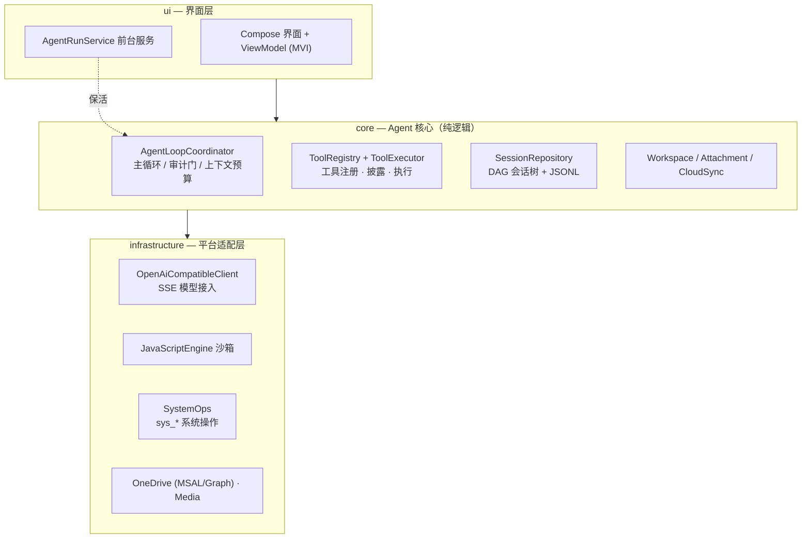
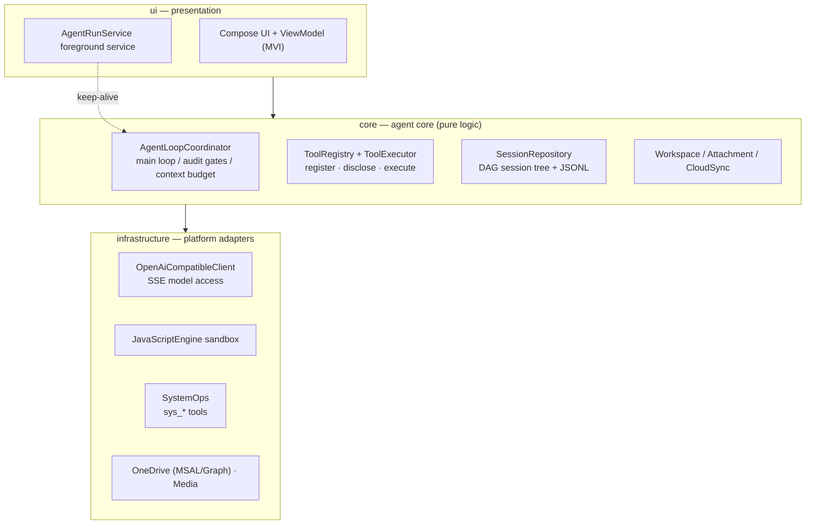

<div align="center">

# SimplyWork

**把 AI Agent 装进手机 —— 端侧运行的 Android 智能助手**

[](https://github.com/facean2020/SimplyWork/releases)
[](LICENSE)

[](#english)

</div>

---

## 简介

SimplyWork 是一个运行在 Android 上的个人 AI Agent 应用：把大模型、工具调用和项目工作区放进手机里。它不只是一个聊天客户端 —— 模型可以真正读写你的工作区文件、联网搜索、操作系统能力、执行 JS 片段，并在一个持续运行的 Agent 循环里完成多步任务。

- **自带模型，随时可换**：内置 OpenRouter / DeepSeek / Qwen / OpenAI 四个预设服务商，也支持任意 OpenAI 兼容的自定义端点。
- **SSE 全链路流式**：回复边生成边渲染，支持思考过程（reasoning）展示。
- **任务在前台服务里跑**：切到别的 App 也不中断，通知栏可见进度。

## 功能

### 模型接入
- 四个预设服务商 + 自定义 Base URL（OpenAI 兼容协议，Ktor 实现）
- SSE 流式输出：文本增量、思考增量、工具调用分片、用量统计
- 模型目录自动归一化：上下文窗口、最大输出、视觉能力、价格

### Agent 工具体系
模型通过统一的 Tool Calling 完成一切操作，当前内置：

| 分类 | 工具 |
|------|------|
| 文件系统 | `fs_list` `fs_read` `fs_write` `fs_mkdir` `fs_move` `fs_delete` |
| 任务管理 | `todo_write`（待办拆解，任务闭环由 CompletionGuard 校验） |
| 联网 | `web_search`（Bing + DuckDuckGo 兜底）、`web_fetch` |
| 代码沙箱 | `js_run` / `js_await`（AndroidX JavaScriptEngine 进程隔离执行） |
| 语音 | `tts_tool`（系统 TTS 合成工作区文本） |
| 自操作 | `self_config_read/update`、`self_session_read`、`self_project_create` |
| 系统操作 | `sys_*` 共 13 个：打开应用/DeepLink、剪贴板、日历、通知、分享、时间与计算、设备信息、应用列表、位置 |

- **前置 / 后置双审计门禁**：高危工具调用前弹出人工确认（HITL），结果返回后做脱敏与有效性校验

### 项目与会话
- **多项目工作区**：每个项目独立的文件空间，可浏览、编辑、diff，并用外部应用打开预览
- **按项目配置 `soul.md`**：给不同项目设定不同人格/系统提示
- **会话持久化双介质**：SQLite 存 DAG 分支结构，每会话一个追加式 JSONL 存消息（先 fsync 再提交）
- **附件**：图片（Photo Picker，自动降采样至长边 1568px）与文档（txt / md 文本提取），随消息进入模型
- **OneDrive 云同步**：MSAL 登录个人账户，项目文件云端备份/同步

### 工程质量
- Jetpack Compose + Material3，MVI 单向数据流
- R8 混淆 + 资源收缩，release 正式签名
- 47 个 JVM 单元测试（JUnit / Turbine / MockK / Ktor Mock）

## 架构

三层结构，依赖方向自上而下；`core` 为纯逻辑不依赖 Android API，便于 JVM 单测：



**一轮 Agent 循环的数据流**：用户输入（可带附件）→ 组装上下文（工具清单 + 待办状态 + 预算检查）→ 调用模型（SSE 流式）→ 若返回 Tool Calling：前置审计 → 执行 → 后置审计 → 结果回填，进入下一轮；若无工具调用：CompletionGuard 检查任务是否闭环，未闭环则注入 Follow-up 继续，闭环则结束本轮。

### 目录结构

```
app/src/main/java/com/yangz3720/simplywork/
├── ui/              # Compose 界面、ViewModel、设置页
├── core/            # Agent 循环、工具、会话、附件、工作区、云同步引擎
├── infrastructure/  # 模型客户端、JS 沙箱、系统操作、OneDrive、媒体
├── service/         # AgentRunService 前台服务
├── AppContainer.kt  # 组合根（手动 DI）
└── ProviderKeyring.kt  # 多服务商 API Key 与偏好设置
```

更多设计细节见 [`docs/PlaningStages/`](docs/PlaningStages/)。

## 安装

从 [Releases](https://github.com/facean2020/SimplyWork/releases) 下载 `SimplyWork-vX.Y.Z.apk` 直接安装，需要 **Android 14（API 34）及以上**。APK 使用正式发布密钥签名，可覆盖升级。

> 不同签名的 debug 包（`com.yangz3720.simplywork.debug`）与 release 包可并存安装，互不覆盖。

## 从源码构建

```bash
git clone https://github.com/facean2020/SimplyWork.git
cd SimplyWork

# 调试版（无需签名配置）
./gradlew :app:assembleDebug

# 单元测试
./gradlew :app:testDebugUnitTest
```

正式版需要在仓库根目录的 `local.properties`（已被 gitignore）中配置签名后编译：

```properties
RELEASE_STORE_FILE=keystore/xxx.jks
RELEASE_STORE_PASSWORD=...
RELEASE_KEY_ALIAS=...
RELEASE_KEY_PASSWORD=...
```

```bash
./gradlew :app:assembleRelease   # 产物在 app/build/outputs/apk/release/
```

未配置签名时 release 会明确产出 `app-release-unsigned.apk`，不会用空密码签出“看起来正常”的坏包。

### 发布新版本

维护者发版用一键脚本，自动完成「前置检查 → 单元测试 → 编译 → 验签 → 打 tag → 创建 GitHub Release 并上传 APK」：

```bash
scripts/release.sh --dry-run   # 只做检查并打印发版计划
scripts/release.sh             # 正式发版（版本号取自 build.gradle.kts）
```

## 协议

本项目基于 [Apache License 2.0](LICENSE) 开源 —— 可自由使用、修改、分发（含商用），需保留版权与许可声明。

---

<a id="english"></a>

## English

**SimplyWork** is an on-device AI Agent for Android: a large model with real tool access and a project workspace, all running on your phone. It is not just a chat client — the model reads and writes workspace files, searches the web, drives system capabilities, runs JS snippets, and completes multi-step tasks inside a persistent agent loop.

### Features

**Model access**
- Built-in presets for OpenRouter / DeepSeek / Qwen (DashScope) / OpenAI, plus any custom OpenAI-compatible endpoint (Ktor)
- End-to-end SSE streaming: text deltas, reasoning deltas, tool-call chunks, usage stats
- Model catalogue normalisation: context window, max output tokens, vision support, pricing

**Agent tools**
- Filesystem: `fs_list` `fs_read` `fs_write` `fs_mkdir` `fs_move` `fs_delete`
- Task management: `todo_write` (task completion is verified by a CompletionGuard)
- Web: `web_search` (Bing with DuckDuckGo fallback) and `web_fetch`
- Code sandbox: `js_run` / `js_await` (process-isolated via AndroidX JavaScriptEngine)
- Voice: `tts_tool` (system TextToSpeech over a workspace file)
- Self-operations: `self_config_read/update`, `self_session_read`, `self_project_create`
- System ops: 13 `sys_*` tools — open apps/DeepLink, clipboard, calendar, notifications, share, time/calc, device info, app list, location
- **Pre- and post-tool audit gates**: high-risk calls require human approval (HITL); results are sanitised and validated on return

**Projects & sessions**
- Multi-project workspaces with file browsing, editing, diff and external-app preview
- Per-project `soul.md` persona files
- Dual-medium persistence: SQLite for the DAG branch structure, one append-only JSONL per session (fsync before commit)
- Attachments: images (Photo Picker, downsampled to a 1568 px long edge) and documents (txt / md text extraction)
- OneDrive cloud sync via MSAL personal accounts

**Engineering**
- Jetpack Compose + Material3, MVI unidirectional data flow
- R8 shrinking + resource shrinking, release-signed builds
- 47 JVM unit tests (JUnit / Turbine / MockK / Ktor Mock)

### Architecture

Three layers with strictly downward dependencies; `core` is pure logic with no Android API calls, which keeps it testable on the JVM:



**One loop iteration**: user input (optionally with attachments) → assemble context (tool list + todo state + budget check) → call the model (SSE stream) → if tool calls are returned: pre-tool audit → execute → post-tool audit → feed results back, next iteration; if none: CompletionGuard checks whether the task is closed — otherwise a Follow-up is injected and the loop continues.

### Install

Download `SimplyWork-vX.Y.Z.apk` from [Releases](https://github.com/facean2020/SimplyWork/releases) and install it. Requires **Android 14 (API 34)+**. Release APKs are signed with the official key, so they upgrade in place. The debug build uses a separate application id and can be installed alongside.

### Build from source

```bash
git clone https://github.com/facean2020/SimplyWork.git
cd SimplyWork

./gradlew :app:assembleDebug      # debug build, no signing needed
./gradlew :app:testDebugUnitTest  # unit tests
```

Release builds read signing credentials from `local.properties` (gitignored) at the repository root:

```properties
RELEASE_STORE_FILE=keystore/xxx.jks
RELEASE_STORE_PASSWORD=...
RELEASE_KEY_ALIAS=...
RELEASE_KEY_PASSWORD=...
```

```bash
./gradlew :app:assembleRelease   # output in app/build/outputs/apk/release/
```

Without those credentials the release task emits an explicitly named `app-release-unsigned.apk` instead of signing with empty passwords.

### Releasing

Maintainers ship with a single script that runs checks → unit tests → build → signature verification → tag → GitHub Release with the APK attached:

```bash
scripts/release.sh --dry-run   # checks and plan only
scripts/release.sh             # full release (version read from build.gradle.kts)
```

## License

Licensed under the [Apache License 2.0](LICENSE) — free to use, modify and redistribute (including commercially), with copyright and license notices retained.
