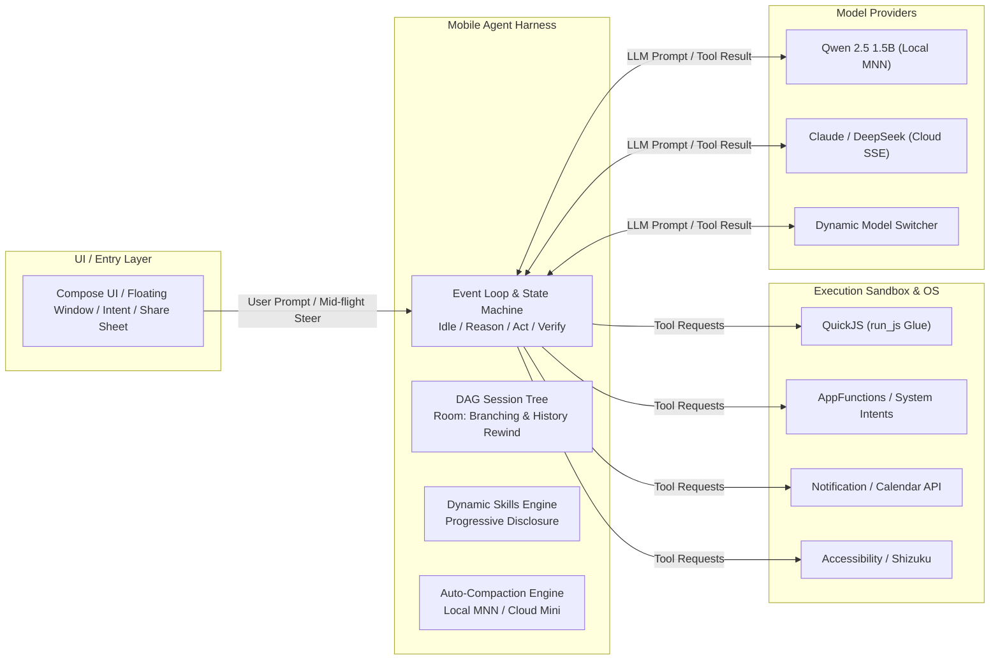

# 移动端轻量 AI Agent 开发架构设计与技术规范

---

## 1. 项目概述与核心哲学

### 1.1 项目定位

本项目旨在构建一款面向 **Android 14+** 旗舰及中高端设备的轻量级个人助理 Agent。与桌面端重型 Coding Agent（如 Claude Code、OpenCode）不同，本项目的核心场景聚焦于：

> **「个人意图分发与轻量数据胶水」（Personal Intent & Data Glue）**

### 1.2 设计哲学

- **剥离桌面负资产**：放弃 LSP 语法诊断、AST 分析、多文件 Diff Patch 及虚拟终端等重型依赖。
- **Pi 极简 Harness 架构**：借鉴 Pi (pi.dev) 的 Minimal Harness 理念，大模型（LLM）仅作为单步推理引擎，状态控制、上下文自愈、动态技能注入与沙盒执行全部由 Kotlin 原生脚手架（Harness）确定性接管。
- **移动原生元操作（Primitives）**：以原生 AppFunctions、System Intents、通知/剪贴板感知及轻量 JS 脚本作为元工具。

---

## 2. 目标平台与硬件准入门槛

### 2.1 操作系统与版本约束

为彻底甩掉老旧系统的历史包袱（避免复杂的 `if-else` 版本兼容逻辑，消除后台被杀、全屏截屏隐私及内存对齐兼容问题），强行约束如下：

| 配置项 | 要求 |
|---|---|
| `minSdk` | 34 (Android 14) |
| `targetSdk` | 35 / 36 (Android 15 / 16) |

### 2.2 二进制与内存对齐规范（16KB Page Size）

NDK 编译必须使用 **NDK r27+**，并在链接器参数中引入 `-Wl,-z,max-page-size=16384`。确保产出的 `.so` 库以 16KB Page Size 对齐，实现向上兼容 Android 15/16（16KB 内核），向下完全兼容 Android 14（4KB 内核）。

### 2.3 双梯队分级运行策略（Tiering Strategy）

应用首次启动时完成硬件探测，自动分配运行模式：

| 检测指标 | 梯队 A：端云协同模式<br/>`HYBRID_LOCAL_CLOUD`                  | 梯队 B：纯云端驱动模式<br/>`CLOUD_ONLY`                           |
|---|-------------------------------------------------------|---------------------------------------------------------|
| Android 版本 | ≥ Android 14 (API 34)                                 | ≥ Android 14 (API 34)                                   |
| 物理内存 (RAM) | ≥ 8 GB（推荐 ≥ 12 GB）                                    | < 8 GB                                                  |
| 剩余存储空间 | ≥ 10.0 GB                                             | < 10.0 GB                                               |
| 图形/算力 | 支持 Vulkan 1.2+                                        | 不限                                                      |
| 端侧小模型应用 | 运行 LiteRT / MNN (Qwen-2.5-1.5B INT4) 进行离线意图路由与上下文自动压缩 | 停用本地推理；所有路由与上下文压缩转由云端轻量模型（如 DeepSeek-V3 / Qwen-Turbo）处理 |

---

## 3. 技术栈选型

| 层级 | 技术选型 |
|---|---|
| 核心语言与并发 | Kotlin + Coroutines / Flow + Channel（实现流式输出与中途打断/转向 Steer 机制） |
| UI 交互层 | Jetpack Compose + Compose Material3（悬浮窗 / Quick Tile / 系统分享链入口） |
| 轻量代码沙盒 | AndroidX `javascriptengine`（基于 QuickJS），体积 < 1 MB，内存限制 8 MB |
| 会话与 DAG 状态树 | Room Database + Kotlinx.Serialization（支持类似 Pi 的 DAG 树状会话存储与 `/tree` 分支回退） |
| 网络与流式传输 | Ktor Client + Server-Sent Events (SSE) |
| 端侧推理引擎 | Google LiteRT-LLM 或 阿里 MNN（仅在 HYBRID 模式下加载 1GB 级 INT4 端侧小模型） |

---

## 4. 系统架构图



---

## 5. 核心模块设计规范

### 5.1 设备能力检测器（Capability Detector）

```kotlin
import android.app.ActivityManager
import android.content.Context
import android.content.pm.PackageManager
import android.os.Build
import android.os.StatFs

enum class AgentExecutionMode {
    HYBRID_LOCAL_CLOUD,
    CLOUD_ONLY
}

object DeviceCapabilityDetector {
    private const val MIN_LOCAL_RAM_MB = 7500L      // 物理内存标准（约 8GB）
    private const val MIN_LOCAL_STORAGE_MB = 4000L   // 4GB 可用存储空间

    fun evaluate(context: Context): AgentExecutionMode {
        val hasAdequateApi = Build.VERSION.SDK_INT >= Build.VERSION_CODES.UPSIDE_DOWN_CAKE
        val hasAdequateRam = getTotalRamMb(context) >= MIN_LOCAL_RAM_MB
        val hasAdequateStorage = getAvailableStorageMb(context) >= MIN_LOCAL_STORAGE_MB
        val hasVulkan = context.packageManager.hasSystemFeature(
            PackageManager.FEATURE_VULKAN_HARDWARE_VERSION
        )

        return if (hasAdequateApi && hasAdequateRam && hasAdequateStorage && hasVulkan) {
            AgentExecutionMode.HYBRID_LOCAL_CLOUD
        } else {
            AgentExecutionMode.CLOUD_ONLY
        }
    }

    private fun getTotalRamMb(context: Context): Long {
        val actManager = context.getSystemService(Context.ACTIVITY_SERVICE) as ActivityManager
        val memInfo = ActivityManager.MemoryInfo()
        actManager.getMemoryInfo(memInfo)
        return memInfo.totalMem / (1024 * 1024)
    }

    private fun getAvailableStorageMb(context: Context): Long {
        val stat = StatFs(context.filesDir.absolutePath)
        return (stat.availableBlocksLong * stat.blockSizeLong) / (1024 * 1024)
    }
}
```

### 5.2 动态技能渐进加载（Dynamic Skills Engine）

为了减少 Context 浪费和模型幻觉，采用**渐进式暴露机制**：

1. **一级暴露**：初始化时，仅向 System Prompt 注入技能名与一句话简介（< 100 tokens）。
2. **二级挂载**：当用户意图被意图路由器或主模型命中时，才动态将完整的 JSON Schema 及提示词模板注入该轮对话。

```kotlin
data class AgentSkill(
    val name: String,
    val description: String,
    val promptTemplate: String,
    val tools: List<AgentTool>
)

interface AgentTool {
    val name: String
    val parametersSchema: String
    suspend fun execute(paramsJson: String): ToolResult
}

sealed class ToolResult {
    data class Success(val output: String) : ToolResult()
    data class Error(val message: String) : ToolResult()
}
```

### 5.3 内存数据胶水沙盒（QuickJS Engine）

内置元工具 `run_js`，解决数据清洗、正则匹配、数学计算与数据结构转换等轻量逻辑。

```kotlin
class QuickJsTool(private val context: Context) : AgentTool {
    override val name = "run_js"
    override val parametersSchema = """
    {
        "type": "object",
        "properties": {
            "code": { "type": "string", "description": "JavaScript Code to run in sandbox" }
        },
        "required": ["code"]
    }
    """.trimIndent()

    override suspend fun execute(paramsJson: String): ToolResult {
        // 使用 AndroidX JavaScriptEngine 开启隔离进程执行
        return try {
            val code = extractCode(paramsJson)
            val result = executeInQuickJs(code)
            ToolResult.Success(result)
        } catch (e: Exception) {
            ToolResult.Error("JS Execution Failed: ${e.message}")
        }
    }

    private fun extractCode(json: String): String {
        // 解析代码提取逻辑
        return json
    }

    private suspend fun executeInQuickJs(code: String): String {
        // 调用 JS Sandbox 运行并返回结果
        return "Executed Result"
    }
}
```

### 5.4 可打断与中途转向事件循环（Steer-capable Event Loop）

```kotlin
sealed class AgentStepEvent {
    data class Thinking(val thought: String) : AgentStepEvent()
    data class ExecutingTool(val toolName: String, val params: String) : AgentStepEvent()
    data class Done(val finalAnswer: String) : AgentStepEvent()
    data class Error(val throwable: Throwable) : AgentStepEvent()
}

class AgentHarnessLoop(
    private val modelProvider: ModelProvider,
    private val toolRegistry: ToolRegistry
) {
    private val steerChannel = Channel<String>(Channel.UNLIMITED)

    // 用户中途强行插入的转向指令
    fun steer(userOverridePrompt: String) {
        steerChannel.trySend(userOverridePrompt)
    }

    fun run(initialPrompt: String): Flow<AgentStepEvent> = flow {
        var contextHistory = mutableListOf<Message>()
        contextHistory.add(Message.User(initialPrompt))

        while (true) {
            // 1. 检查是否有用户中途插入的指令
            val steerMsg = steerChannel.tryReceive().getOrNull()
            if (steerMsg != null) {
                contextHistory.add(Message.System("User redirected priority: $steerMsg"))
            }

            // 2. 触发 LLM 推理
            val response = modelProvider.generate(contextHistory)

            if (response.isFinalAnswer) {
                emit(AgentStepEvent.Done(response.text))
                break
            }

            if (response.hasToolCalls) {
                for (call in response.toolCalls) {
                    emit(AgentStepEvent.ExecutingTool(call.toolName, call.params))
                    val tool = toolRegistry.getTool(call.toolName)
                    val result = tool?.execute(call.params) 
                        ?: ToolResult.Error("Tool not found")

                    contextHistory.add(Message.ToolOutput(call.id, result))
                }
            }
        }
    }
}
```

---

## 6. 开发实施路线图（Roadmap）

### 第一阶段：极简内核与沙盒搭建

- 搭建基础项目框架（minSdk = 34）
- 集成 Ktor SSE 连接云端 LLM (DeepSeek / Claude)
- 集成 AndroidX `javascriptengine` 并实现 `run_js` 工具
- 完成单步 Tool Call 循环

### 第二阶段：Harness 状态树与硬件分级

- 接入 Room 实现 DAG 会话树管理与分支回退
- 实现 `DeviceCapabilityDetector`，完成首次启动的物理内存、存储与 Vulkan 探测
- 在本地集成 MNN/LiteRT 驱动 Qwen-2.5-1.5B INT4 模型（仅 HYBRID 模式）

### 第三阶段：动态 Skill 扩展与系统连接

- 实现 SKILLS.md / JSON 规范的 Dynamic Skills 注册引擎
- 开发生活级技能：日历事件同步、短信/剪贴板格式化解析、账单通知清洗
- 对接 Android 15 AppFunctions 与 Shizuku 底层模拟点击（作为 UI 自动化兜底方案）

### 第四阶段：上下文自愈与稳健性重构

- 实现后台静默上下文自动压缩（Auto-Compaction）循环
- 完善 Channel 消息驱动的中途强行打断（Steer）机制
- 编写端到端单元测试与自动化回归测试
