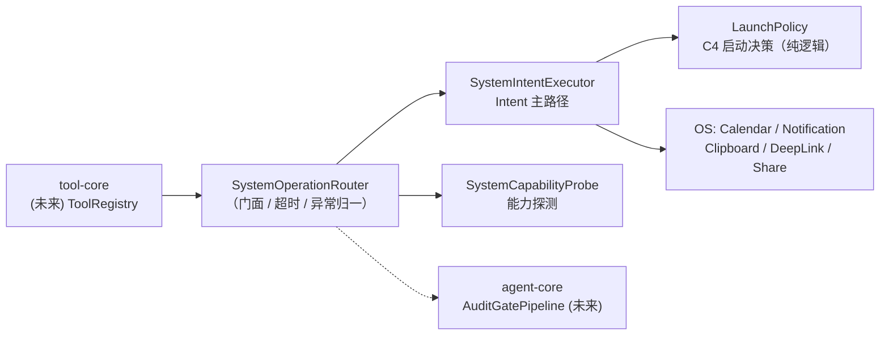

# 系统元操作层设计（SystemOps / Intent 主路径）

> **状态**：设计基线 v1.2（2026-09-11）
> **上游文档**：`architecture.md` / `android-agent.md`
> **关系**：本文档细化 `architecture.md` 中「基础提供层 → app-function」一节，作为实现的唯一设计依据。原一节中的粗粒度描述与本文冲突时，**以本文为准**。
> **实现状态**：**Phase 1 + Phase 4 已实现**（`infrastructure.systemops`）。
>
> **v1.2 修订（读侧能力补齐 2026-09-11）**：
> - **新增 6 个 `sys_*` 读工具**（目录 7 → 13）：`sys_time_read` / `sys_time_calc` / `sys_device_read` / `sys_app_list` / `sys_calendar_query` / `sys_location_read`。动机是模型侧的三个硬缺口：
>   1. **模型没有任何时间感**：`AgentConfig.DEFAULT_SYSTEM_PROMPT` 与 `AgentContextAssembler` 的注入链都不含当前时间，而 `sys_calendar_insert` 的入参是 `startTimeEpochMs`（int64 epoch 毫秒）——没有读钟工具，任何排期都只能靠猜，日历写入实际处于残废状态。修复取**每轮注入**而非每节点注入（v1.2 复核裁决）：仅 `UserPrompt` 节点在装配期前置一行 `[message time: yyyy-MM-dd EEE HH:mm UTC±HH:mm]`（墙钟可读格式，时区规则已把夏令时折进偏移量，epoch 不给模型），工具/助手/结果节点零开销；系统提示同步声明该前缀的语义与"日期敏感调用仍需 `sys_time_read`"。
>   2. **日历只有写没有读**：无法回答"今天/本周有什么安排"。
>   3. **完全没有定位与应用清单**：`sys_app_open` 要求模型给出精确包名，但没有列举手段，只能猜包名并稳定吃到 `target_not_found`。
> - **执行路径不新增**：6 个读工具全部继续走 `SystemOperationRouter`（继承超时 + 异常归一 + 计时），`ExecutionPath` 不扩枚举。它们不是 Intent，但 v1.1 起 `SystemIntentExecutor` 实际已承载 ClipboardManager / NotificationManager 等非 Intent 操作，沿用同一执行器以免为一个命名洁癖改动门面契约。**记为命名债**：执行器现名与职责已不符，待 tool-core 正式落地时一并更名。
> - **新增 P4 权限申请缝 `SystemPermissionRequester`**：基础设施仍然**不弹**任何对话框，但可以在缺权限时"邀请"UI 层去弹，拿到结果后**复查**权限再决定放行。这与 agent-core 的 `AuditApprovalHandler` 完全同构（后台循环挂起等 UI 决策），UI 侧实现为 `PermissionCoordinator`（对齐既有 `ApprovalCoordinator`）。此前全 App 只有 `checkSelfPermission` 检查、没有任何申请代码，`PermissionRequired` 是死路。
> - **依赖仍然零新增**：定位走框架 `LocationManager`（工程无 Play Services，不为此引入）；日期走 `java.time`（minSdk 34，不引入 kotlinx-datetime）；反向地理编码走框架 `Geocoder` 非弃用的 `GeocodeListener` 重载。
> - 原 v1.1 修订记录见下。
>
> **v1.1 修订（评审结论 2026-08-30）**：
> - **剔除 AppFunctions 增强路径**：侧载分发拿不到 `EXECUTE_APP_FUNCTIONS` 门禁（signature|privileged + 角色白名单），且引入 compileSdk 36 工具链升级负担，收益为零 → 整条路径取消（原 §5.2 / C1 / C2 / C7 / C8 / Q1 / Q2 / Q5 一并废止）。
> - **拒绝接入 Shizuku**：用户决策，Shell 命令路径不再规划。
> - **Automation 兜底路径整体延后**：AccessibilityService 未排期（Shizuku 已否决；将来若恢复 UI 模拟能力，随 HIGH_RISK 等级一并回归）。
> - 保留：**系统意图（Intent 主路径）+ 系统探测（CapabilityProbe）**，即原 Phase 1 全量内容。
> - 模块更名：`app-function` → `systemops`（名副其实）。

---

## 1. 定位与设计原则

`systemops` 是 Infrastructure 的最底层「系统元操作落地层」：向上将被 `tool-core` 的 `ToolRegistry` 收敛为可执行工具，被 `agent-core` 的 `AuditGatePipeline` 审计；向下直面 Android 平台的权限门禁与系统限制。

五条设计原则（评审结论的固化，v1.1）：

| # | 原则 | 说明 |
|---|---|---|
| P1 | **Intent 是唯一执行路径** | 原「Intent 主路径，AppFunctions 可选增强，Automation 兜底」降级矩阵收敛为单路径；AppFunctions（API 36 门禁不可得）与 Automation（Shizuku 否决 / Accessibility 延后）移出范围 |
| P2 | **失败必须显式** | 禁止静默 `null` / `false`。系统限制（如后台读剪贴板被禁）必须以带原因的失败结果返回，让 Agent 能自愈追问，而非误判为"数据为空" |
| P3 | **一切可审计** | 每个操作规格（Spec）携带危险等级，映射到 `AuditGatePipeline` 的 Pre-Tool 审计策略（§6.2）；危险等级贯通到 tool-core |
| P4 | **权限申请归 UI，基础设施只报告** | 基础设施层不弹权限对话框，只返回 `PermissionRequired` 结果；申请 UX 由 UI 层的权限控制器统一编排 |
| P5 | **全挂起式 + 超时语义** | 所有跨进程调用必须可超时、可取消；Router 层统一计时并保证调用方在时限内拿到结果（进行中的 binder 调用无法中断，完成后其结果被丢弃） |

---

## 2. 平台现实与硬约束

设计必须先承认以下平台事实，任何与事实冲突的接口签名都应视为缺陷：

| # | 平台约束 | 版本 | 对本项目的影响 |
|---|---|---|---|
| C3 | **后台读写剪贴板被系统禁止**：仅默认 IME 与前台焦点应用可读写 | Android 10+ | 剪贴板读写必须先做前台判定，非前台显式返回 `SecurityBlocked`，不得静默 null（P2 核心锚点） |
| C4 | **后台启动 Activity 受限**，且系统**静默丢弃**（不抛异常）| Android 10+ | 发 DeepLink / 分享面板前必须先决策（`LaunchPolicy`）：前台 → 直接发；有 SAW 豁免 → 直接发；否则降级为通知路径（用户点击通知 = 用户主动，天然合规）|
| C5 | `POST_NOTIFICATIONS` 为运行时权限 | API 33+（本项目 minSdk 34，全量适用） | 发通知前必须探测并返回 `PermissionRequired` |
| C6 | 侧载应用启用 AccessibilityService 受 **Restricted Settings** 限制 | Android 13+ | 仅与延后的 Automation 路径相关，恢复排期时须提供引导 UI |
| C9 | **定位是"权限 + 开关"双重门禁**：`ACCESS_COARSE_LOCATION` / `ACCESS_FINE_LOCATION` 是运行时权限，且设备"位置"总开关关闭时所有 provider 均不可用 | Android 6+ / 全量 | 两者必须可区分：缺权限 → `PermissionRequired`（可申请）；provider 全关 → `SecurityBlocked`（用户须去系统设置打开，申请权限无用）。混淆两者会让模型盲目重试（P2） |
| C10 | **反向地理编码不是本地操作**：框架 `Geocoder` 的实现可能自连网络，且部分 ROM 无后端 | 全版本 | `includeAddress` 只能是**软字段**：无后端 / 超时 / 无结果时写 `addressUnavailable`，绝不让整次定位失败——坐标本身已经有效 |

> 工具链现状：AGP 8.8 / compileSdk 35 / minSdk 34 / Kotlin 2.1。全部能力在 API 34/35 基线内实现，**无任何 API 36 依赖**。
> Manifest 声明：`POST_NOTIFICATIONS`、`READ_CALENDAR`（`sys_calendar_query` + DIRECT_WRITE 用）/ `WRITE_CALENDAR`（仅 DIRECT_WRITE 用）、`SYSTEM_ALERT_WINDOW`（C4 豁免，设置页授予）、`QUERY_ALL_PACKAGES`（侧载分发，免去逐目标 `<queries>` 声明）、`ACCESS_NETWORK_STATE`（`sys_device_read` 读网络能力，normal 权限装即授）、`ACCESS_COARSE_LOCATION` / `ACCESS_FINE_LOCATION`（`sys_location_read`，运行时），另有 `android.hardware.location(.gps)` 声明为 `required=false`（无定位硬件的设备上 App 仍可安装，工具退化为 `SecurityBlocked`）。

---

## 3. 总体架构

### 3.1 组件拓扑



- `SystemOperationRouter` 是本模块对 tool-core 的**唯一门面**：spec 分发 → 超时包裹 → 异常归一（§4.3）→ 统一计时。
- `SystemCapabilityProbe` 提供慢变化能力快照（通知权限、SAW 豁免）；前台焦点状态**不入缓存**，由执行器在调用时采样。
- `LaunchPolicy` 是 C4 决策矩阵的纯函数实现（无 Android 依赖），全矩阵可 JVM 单测。

### 3.2 操作 → 路径映射（v1.1 单路径）

| 操作类别 | 执行方式 | 关键约束 |
|---|---|---|
| 打开 App / DeepLink 跳转 | Intent（前台/SAW 直启，否则通知兜底） | C4 |
| 写日历事件 | EDITOR_INTENT（默认，免权限）或 DIRECT_WRITE（需运行时权限） | P4 |
| 读 / 写剪贴板 | ClipboardManager（仅前台焦点） | C3 |
| 发通知 | NotificationManager（需 C5 权限） | C5 |
| 系统分享 | ACTION_SEND chooser（同 C4 策略） | C4 |
| 读当前时间 / 相对日期推算 | 进程内 `java.time`（无 I/O、无权限） | — |
| 读设备状态（电量/网络/存储/内存/机型） | `registerReceiver(null, …)` 粘滞广播 + `ConnectivityManager` + `StatFs` + `ActivityManager` | C10 无关；`ACCESS_NETWORK_STATE` 为 normal 权限 |
| 读已安装应用清单 | `PackageManager.queryIntentActivities` / `getInstalledPackages` | 依赖 `QUERY_ALL_PACKAGES` 才有完整可见性 |
| 读日历事件 | `ContentResolver` 查 `CalendarContract.Instances`（**不是 Events**：只有 Instances 会把周期事件展开成真实发生次） | READ_CALENDAR（运行时） |
| 读设备定位 | 框架 `LocationManager`（无 Play Services 依赖）：按精度排序遍历**全部已启用 provider**（GPS 拿剩余预算，网络/passive 各 1.2 s 快片），缓存与新鲜 fix 取 `getTime()` 较新者；单次定位预算 = 总预算 9 s 减去已耗时间与 Geocoder 保留片，**不是固定常数相加** | C9 双门禁；C10 地址为软字段 |

> v1.2 读侧一览：这 6 类操作**都不是 Intent**，但一律经 `SystemOperationRouter` 分发，以继承超时（10 s）、异常归一与统一计时。§3.1「Router 是唯一门面」是硬约束——读操作也不许旁路。

---

## 4. 统一数据模型

### 4.1 统一结果模型

```kotlin
package com.yangz3720.simplywork.infrastructure.systemops.model

@Serializable
enum class ExecutionPath { SYSTEM_INTENT }   // v1.1：唯一路径；Automation 回归时扩展

@Serializable
sealed interface SystemOperationResult {
    data class Success(
        val outputJson: JsonObject? = null,
        val executedVia: ExecutionPath = ExecutionPath.SYSTEM_INTENT,
        val executionTimeMs: Long = 0L        // Router 统一计时盖章
    ) : SystemOperationResult

    data class PermissionRequired(val permissions: List<String>, val rationale: String) : SystemOperationResult  // P4
    data class SecurityBlocked(val reason: String) : SystemOperationResult            // C3 等
    data class TargetNotFound(val target: String) : SystemOperationResult
    data class Timeout(val timeoutMs: Long, val executionTimeMs: Long) : SystemOperationResult
    data class Failed(val message: String, val cause: String? = null) : SystemOperationResult
}
```

> 修订说明：原 `PathUnavailable` / `UnavailableReason` 随 AppFunction / Automation 路径剔除而移除；六分支在 Intent 单路径下全部可达。

### 4.2 操作规格（Spec）与危险等级

```kotlin
enum class DangerLevel { SAFE, USER_VISIBLE, USER_CONFIRMING }   // v1.1：HIGH_RISK 随 Automation 回归

sealed interface OperationSpec { val dangerLevel: DangerLevel }

@Serializable data class DeepLinkSpec(val uri: String, val launchContext: LaunchContext = LaunchContext.AUTO)
@Serializable data class AppOpenSpec(val packageName: String)
@Serializable data object ClipboardReadSpec
@Serializable data class ClipboardWriteSpec(val label: String, val text: String)
@Serializable data class CalendarInsertSpec(
    val title: String, val description: String? = null, val location: String? = null,
    val startTimeEpochMs: Long, val endTimeEpochMs: Long,
    val isAllDay: Boolean = false, val mode: CalendarWriteMode = CalendarWriteMode.EDITOR_INTENT
) { override val dangerLevel get() = if (mode == DIRECT_WRITE) USER_CONFIRMING else USER_VISIBLE }
@Serializable data class NotificationPostSpec(val channelId: String, val title: String, val message: String, val priority: Int = 0)
@Serializable data class ShareTextSpec(val title: String, val content: String)

enum class LaunchContext { AUTO, FOREGROUND_NOW, FROM_OVERLAY_SERVICE, VIA_NOTIFICATION_FALLBACK }
enum class CalendarWriteMode { EDITOR_INTENT, DIRECT_WRITE }

// ----- v1.2 读侧规格 -----
@Serializable data object TimeReadSpec                       // SAFE
@Serializable data class TimeCalcSpec(
    val amount: Int = 0, val unit: TimeUnit = TimeUnit.DAY,
    val weekday: Weekday? = null, val timeOfDay: String? = null, val baseEpochMs: Long? = null
)                                                                          // SAFE
@Serializable data object DeviceReadSpec                     // SAFE
@Serializable data class AppListSpec(val query: String? = null, val limit: Int = 40, val launchableOnly: Boolean = true)  // SAFE
@Serializable data class CalendarQuerySpec(
    val startTimeEpochMs: Long? = null, val endTimeEpochMs: Long? = null,
    val query: String? = null, val limit: Int = 20
)                                                                          // USER_CONFIRMING
@Serializable data class LocationReadSpec(
    val accuracy: LocationAccuracy = LocationAccuracy.APPROXIMATE,
    val maxAgeSeconds: Int = 120, val includeAddress: Boolean = false
)                                                                          // USER_CONFIRMING

enum class TimeUnit { SECOND, MINUTE, HOUR, DAY, WEEK, MONTH, YEAR }
enum class Weekday { MONDAY, …, SUNDAY }
enum class LocationAccuracy { APPROXIMATE, PRECISE }
```

> **读侧危险等级的划分依据是"数据归属"，不是"操作类型"**：时钟、电量、包列表是设备状态 → `SAFE`；日程内容与实时坐标是用户私有数据 → `USER_CONFIRMING`（每次调用都过 HITL）。注意 `sys_calendar_query` 比 `sys_calendar_insert` 的默认模式（`EDITOR_INTENT` = `USER_VISIBLE`）**更受限**——编辑器由日历 App 自行确认且从不把既有日程暴露给我们，而查询是把整本日程读进上下文。
> **`TimeCalcSpec` 三步语义固定**：先按 `amount`+`unit` 偏移 → 再**严格向后**推进到 `weekday`（`next(FRIDAY)` 不含当天，这正是"下周五"；"这周五"用 amount/unit 表达）→ 最后用 `timeOfDay` 覆盖时刻。月/年偏移按 `java.time` 语义钳制到合法日（1/31 + 1 月 = 2/28）。

> 修订说明：`ClipboardReadSpec.foregroundOnly` 移除——Intent 单路径下剪贴板**永远**前台判定，参数无意义。时间统一 `epochMs`（免引入 kotlinx-datetime）；all-day 事件按本地午夜对齐（结束时间为次日午夜，排他）。

### 4.3 异常体系衔接

`InfrastructureException.SystemOperation`（`error/InfrastructureExceptions.kt`：IntentLaunchFailed / ClipboardOperationFailed / CalendarWriteFailed / NotificationPostFailed，v1.2 增补 CalendarQueryFailed / LocationReadFailed / AppInventoryFailed）是**抛出型异常**通道，用于执行器内部错误冒泡；对 LLM/tool-core 的**结果型反馈**一律走 `SystemOperationResult`。Router 统一 catch 并归一为 `Failed`，并放行外部取消（`CancellationException` 原样重抛）。

> v1.2 补一句边界：**权限缺失与开关关闭不是异常**，走 `PermissionRequired` / `SecurityBlocked` 结果通道；只有 provider 崩溃、`PackageManager` 抛错这类基础设施故障才进抛出通道。

---

## 5. 组件契约（已实现签名）

### 5.1 `SystemCapabilityProbe.kt` — 能力探测

```kotlin
data class SystemCapabilities(
    val notificationsPermissionGranted: Boolean,   // C5
    val canLaunchActivityFromBackground: Boolean   // C4：SAW 豁免判定（Settings.canDrawOverlays）
)

interface SystemCapabilityProbe {
    fun observe(): Flow<SystemCapabilities>   // 冷流：每次订阅重估（两项检查开销极小）
    fun snapshot(): SystemCapabilities        // 每次调用现值
}
```

### 5.2 `SystemIntentExecutor.kt` — Intent 主路径

```kotlin
interface SystemIntentExecutor {
    suspend fun launchDeepLink(uri: String, launchContext: LaunchContext = AUTO): SystemOperationResult
    suspend fun openApp(packageName: String): SystemOperationResult        // 无匹配 → TargetNotFound
    suspend fun readClipboard(): SystemOperationResult                     // 非前台 → SecurityBlocked（C3）
    suspend fun writeClipboard(label: String, text: String): SystemOperationResult
    suspend fun insertCalendarEvent(event: CalendarInsertSpec): SystemOperationResult
    suspend fun postNotification(spec: NotificationPostSpec): SystemOperationResult   // C5 → PermissionRequired
    suspend fun shareText(title: String, content: String): SystemOperationResult
}
```

实现要点：
- **C4 决策先行**：`LaunchPolicy.decide(launchContext, isForeground, canDrawOverlays) → StartActivityNow | NotifyFallback | Blocked`。因为系统对后台启动是静默丢弃而非报错，选路必须发生在发射之前。
- **通知兜底可观测**：降级为通知时 `Success(outputJson = { "launched": false, "deliveredVia": "notification" })`，不冒充直启成功。
- **前台判定**：`ActivityManager.runningAppProcesses` 中本进程 importance ≤ FOREGROUND；注入式 `isAppForeground: () -> Boolean` 供 instrumented 测试固定状态。
- **日历 DIRECT_WRITE**：先查可写日历（`CALENDAR_ACCESS_LEVEL >= CAL_ACCESS_CONTRIBUTOR`）再插 `Events`；无可写日历 → `Failed` 显式。
- **通知渠道**：按 spec.channelId 按需创建（IMPORTANCE_DEFAULT），渠道策展后续归 UI 层。

> 原 §5.2 AppFunctionBridge / Schema Adapter 已随路径剔除废止；原 §5.4 AutomationFallbackGateway（Shizuku / Accessibility）延后，契约文档在恢复排期时另行补写。

### 5.3 `SystemOperationRouter.kt` — 门面

```kotlin
interface SystemOperationRouter {
    suspend fun execute(spec: OperationSpec, timeoutMs: Long = DEFAULT_OP_TIMEOUT_MS): SystemOperationResult
    fun capabilities(): SystemCapabilities
    fun observeCapabilities(): Flow<SystemCapabilities>
    companion object { const val DEFAULT_OP_TIMEOUT_MS = 10_000L }
}
```

### 5.4 `SystemOperationToolFactory.kt` — tool-core 收敛（§6.1 落点）

- 13 个封闭工具（v1.1 七个：`sys_deeplink_open` / `sys_app_open` / `sys_clipboard_read` / `sys_clipboard_write` / `sys_calendar_insert` / `sys_notify_post` / `sys_share_text`；v1.2 读侧六个：`sys_time_read` / `sys_time_calc` / `sys_device_read` / `sys_app_list` / `sys_calendar_query` / `sys_location_read`），`SystemToolEntry(definition, dangerLevel, specKind)` 携带审计元数据（P3）。
- `parseArguments(toolName, argumentsJson): Result<OperationSpec>` 供 tool-core 把模型产物还原为 spec 再交给 Router 分发；容忍未知多余键，缺必填字段即失败。
- **参数越界在解析期抛、不在执行期静默钳制**：`limit` / `maxAgeSeconds` / `amount` / `timeOfDay` 越界即 `Result.failure`，审计门禁据此产出 `Deny("Invalid arguments: …")` 回流模型自纠（P2）。静默钳制会把模型的错误从它自己眼前藏起来。
- `sys_time_read` 的描述里显式要求"先调用它再回答任何 today/now 问题、再构造其它工具的 epochMs"——这是让模型真正用起来的关键，不能只靠工具名。
- `sys_app_list` 的描述显式指向 `sys_app_open`（"先查包名再打开"），把两个工具串成模型能照做的顺序。

### 5.5 v1.3 自操作工具族（`SelfOpsTools.kt`，不走 Router）

用户定调的"操作自己"四件套：配置 hook + 只读会话记录 + 内部沙箱 + 项目工作空间。
这些**不是 Android 系统能力**，与 `todo_write` 同构：以 `RegisteredTool` 直接注册进 `AgentToolRegistry`，**不走 SystemOperationRouter**（`sys_*` → Router 的不变量保持干净）。

- **Android 能否操作自己**：能。App 私有目录（`filesDir` 等）读写不需要任何权限；但让 agent 裸写 `shared_prefs`/SQLite 是自毁行为，所以配置 hook 只暴露**类型化白名单缝 `AgentSelfConfig`**（AppContainer 实现），与 UI 点选同源。
- 工具目录（10 个）：
  | 工具 | 等级 | 说明 |
  |---|---|---|
  | `self_config_read` | SAFE | 选择/超时/账号（仅 `hasKey`，API Key 本体永不出缝）/项目列表/当前项目 |
  | `self_config_update` | USER_CONFIRMING | 白名单变更：切换 provider+model（必须成对）、timeoutMs（1000..600000）、当前项目；run 内改动只落盘，下一轮 run 生效（`rebuildPending` 声明） |
  | `self_session_read` | SAFE | mode=list（会话元数据）或 read（活跃路径节点 + payload，默认当前会话，可跨会话只读） |
  | `self_project_create` | SAFE | 建项目（名字 ≤48、大小写不敏感去重），沙箱目录与项目同生，不切当前 |
  | `fs_list` / `fs_read` / `fs_write` / `fs_mkdir` | SAFE | 项目沙箱内自由（Code Interpreter 语义）；读 256KB 截断声明、写 256KB 拒绝、列目录 500 条 `truncated` |
  | `fs_move` | USER_VISIBLE | 目标存在即拒绝（不静默覆盖） |
  | `fs_delete` | USER_CONFIRMING | 非空目录需 `recursive=true`；项目根不可删 |
- **`AgentWorkspace` 路径安全**（`core/workspace/`，纯 File、JVM 可测）：projectId 白名单正则；相对路径 canonical 化后必须仍在项目目录内（`../`、绝对路径、符号链接跳出显式拒绝）；base 必须 canonical（macOS `/var→/private/var` 符号链接会让非 canonical base 把所有合法路径误判为逃逸——已修）。
- **项目**：`ProjectStore`（SharedPreferences JSON + 当前指针，指针失效回落默认项目）、`sessions.project_id` 列（SqliteSessionStore **v2 原地 ALTER TABLE 迁移，不再 drop**；NULL 行按默认项目 `default` 归属渲染）；UI 抽屉按当前项目过滤会话 + 项目切换/新建弹层。
- **配置重建时序**：agent 自改配置 → keyring 落盘 + `configVersion` 自增；VM 观察到且**空闲**时 `rebuildRuntimeIfNeeded()`（run 内重建会换掉运行中的 coordinator，run 结束后同样落地）。

---

## 6. 与 Core 层的集成（待 tool-core / agent-core 实现时对接）

### 6.1 tool-core 收敛

`SystemToolEntry` 注册进 `ToolRegistry` 时，`dangerLevel` 随注册写入危险等级字段——这是 P3 的落点。工具命名空间 `sys_*` 与其他来源工具隔离。

### 6.2 审计策略映射（AuditGatePipeline）

| DangerLevel | Pre-Tool Audit 策略 |
|---|---|
| SAFE | 放行；Post-Gate 对产出做 PII 脱敏（如剪贴板内容进上下文前） |
| USER_VISIBLE | 放行；通过 UI 层知会用户已执行 |
| USER_CONFIRMING | 默认 HITL（`AuditApprovalDialog`），可在设置中按工具粒度降为放行 |
| HIGH_RISK | *（v1.1 空缺，随 Automation 路径回归；届时强制 HITL 不可配置跳过）* |

---

## 7. 实施状态

| 阶段 | 内容 | 状态 |
|---|---|---|
| ~~Phase 1~~ | 统一数据模型 + `SystemCapabilityProbe` + `SystemIntentExecutor` + `SystemOperationRouter` + `SystemOperationToolFactory` | **✅ 已实现**（2026-08-30，JVM 单测 26 项通过；Manifest 权限已声明） |
| ~~Phase 2~~ | `AppFunctionBridge` + Schema Adapter | **❌ 取消**（门禁不可得 + 工具链升级成本，评审结论 v1.1） |
| Phase 3 | Automation 兜底（Accessibility；Shizuku 已否决） | **⏸ 延后未排期**；回归时恢复 HIGH_RISK 与 §5.4 契约 |
| ~~Phase 4~~ | v1.2 读侧工具六个 + P4 权限申请缝 | **✅ 已实现**（2026-09-11；JVM 单测 154 项通过，含 `TimeCalculationTest` 22 项日期数学） |

依赖项：**零新增**（复用 kotlinx-serialization / coroutines / androidx.core；未引入 shizuku、kotlinx-datetime、play-services）。定位与反向地理编码均走框架 `LocationManager` / `Geocoder`。

> **Phase 4 真机验证**（2026-09-11，小米真机 USB）：`SystemOpsDeviceAcceptanceTest` + `SystemOpsReadToolAcceptanceTest` 共 **17 用例全部通过**（`am instrument -w` 直驱，权限经 `pm grant` 预授）。真机路径已覆盖：日历 Provider（Instances 展开 + `truncated` 标记）、定位 Provider 遍历与"室内拿不到 fix"的设计内 `Failed`（文案带下一步指引，验收用例已锚定）、运行时权限缺席路径（`pm grant` 移除后复验 `PermissionRequired`）、电量/网络/存储广播快照。仍属欠账：MIUI 类 ROM 的真实授权弹窗交互、`Geocoder` 后端有网地址解析、App 后台时权限申请被平台丢弃的 `CannotAsk` 分支（代码路径存在，需真机前后台切换手工验证）。

---

## 8. 验收测试计划

1. **模型与路由（JVM 单测）✅ 已落地**
   - `OperationSpecDangerLevelTest`：`CalendarInsertSpec` 双模式等级切换、各 Spec 静态等级、v1.2 读侧等级按数据归属分档、读工具默认值保守性（`includeAddress=false`）
   - `SystemOperationRouterTest`：13 类 Spec 分发正确性；异常归一（SystemOperation → Failed / 未知异常 → Failed / 超时 → Timeout）；Success 计时盖章；探测透传；**v1.2 新增**：读工具同样吃超时与异常归一（防"读操作旁路 Router"的回潮）
   - `LaunchPolicyTest`：C4 决策矩阵全分支（前台直启 / SAW 直启 / 通知兜底 / FOREGROUND_NOW 显式拒绝）
   - `SystemCapabilityProbeTest`：快照与冷流重估语义
   - `SystemOperationToolFactoryTest`：13 工具目录 / 等级 / **每个 Schema 闭合且逐属性有描述** / 参数解析往返 / 空参数走默认值 / 越界参数在解析期失败且报错可行动 / 未知键容忍 / 未知工具与缺字段失败
   - **`TimeCalculationTest`（v1.2）**：日期数学钉死在 `Asia/Shanghai` 与固定基准瞬间，不随构建机时区漂移。覆盖正负偏移、严格向后的 weekday 吸附（周五当天问"下周五"必须落到 +7 天）、`timeOfDay` 在偏移之后应用、月末/闰年钳制（1/31+1 月=2/28、2/29+1 年=2/28）、显式 `baseEpochMs` 覆盖"现在"、非法输入失败而非猜测
   - **`PermissionCoordinatorTest`（v1.2）**：挂起→回灌→清理；**取消（含 Router 超时）必须清空挂起态**，否则幽灵弹窗会串到下一次无关运行；迟到的授权结果必须是 no-op；`asRequester()` 适配形状
2. **Intent 路径（instrumented，待真机/模拟器）**
   - 前台读剪贴板成功；后台（无焦点）读 → `SecurityBlocked` 且 reason == "Background clipboard read restricted"（P2 回归锚点）
   - 无匹配包名 → `TargetNotFound`；未授权通知 → `PermissionRequired`
   - 后台发 DeepLink（无 SAW）→ 通知兜底且 `deliveredVia=notification`
   - 日历 EDITOR_INTENT 拉起编辑页；DIRECT_WRITE 权限缺失 → `PermissionRequired`
3. **v1.2 读侧（instrumented，待真机/模拟器 — 尚未验证）**
   - `sys_time_read` / `sys_time_calc` / `sys_device_read`：无权限依赖，可直接断言字段齐全与 epochMs 可被 `sys_calendar_insert` 复用
   - `sys_calendar_query`：授权后能读到事件、周期事件按发生次展开；拒绝授权 → `PermissionRequired`
   - `sys_location_read`：设备"位置"总开关关闭 → `SecurityBlocked`（**不得**与 `PermissionRequired` 混淆，C9）；只授予"大致位置"时 `precisionDegraded` 出现；无 Geocoder 后端的 ROM 上 `includeAddress=true` 仍返回有效坐标 + `addressUnavailable`
   - 权限自愈闭环：未授予时调用 → 系统弹窗出现 → 允许后**同一次调用**直接返回成功，而不是先失败再让模型重试一遍

---

## 9. 开放问题

| # | 问题 | 阶段 |
|---|---|---|
| Q3 | C3：各 OEM 对后台**写**剪贴板的限制细节差异（实现按"与读一致"处理，真机验证待做） | instrumented 前 |
| Q4 | C4：SAW 豁免在后续 targetSdk 演进中的变化；通知兜底的 UX 文案与频控 | UI 层接入时 |
