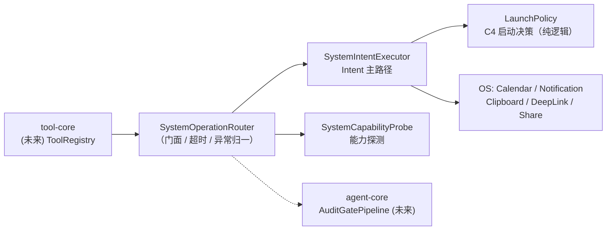

# 系统元操作层设计（SystemOps / Intent 主路径）

> **状态**：设计基线 v1.1（2026-08-30，已实现）
> **上游文档**：`architecture.md` / `android-agent.md`
> **关系**：本文档细化 `architecture.md` 中「基础提供层 → app-function」一节，作为实现的唯一设计依据。原一节中的粗粒度描述与本文冲突时，**以本文为准**。
> **实现状态**：**Phase 1 已实现**（`infrastructure.systemops`，26 个 JVM 单测通过）。
>
> **v1.1 修订（评审结论 2026-08-30）**：
> - **剔除 AppFunctions 增强路径**：侧载分发拿不到 `EXECUTE_APP_FUNCTIONS` 门禁（signature|privileged + 角色白名单），且引入 compileSdk 36 工具链升级负担，收益为零 → 整条路径取消（原 §5.2 / C1 / C2 / C7 / C8 / Q1 / Q2 / Q5 一并废止）。
> - **拒绝接入 Shizuku**：用户决策，Shell 命令路径不再规划。
> - **Automation 兜底路径整体延后**：AccessibilityService 未排期（Shizuku 已否决；将来若恢复 UI 模拟能力，随 HIGH_RISK 等级一并回归）。
> - 保留：**系统意图（Intent 主路径）+ 系统探测（CapabilityProbe）**，即原 Phase 1 全量内容。
> - 模块更名：`app-function` → `systemops`（名副其实）。

---

## 1. 定位与设计原则

`systemops` 是 Infrastructure 的最底层「系统元操作落地层」：向上将被 `tool-core` 的 `ToolRegistry` 收敛为可执行工具，被 `agent-core` 的 `AuditGatePipeline` 审计；向下直面 Android 平台的权限门禁与系统限制。

五条设计原则（评审结论的固化，v1.1）：

| # | 原则 | 说明 |
|---|---|---|
| P1 | **Intent 是唯一执行路径** | 原「Intent 主路径，AppFunctions 可选增强，Automation 兜底」降级矩阵收敛为单路径；AppFunctions（API 36 门禁不可得）与 Automation（Shizuku 否决 / Accessibility 延后）移出范围 |
| P2 | **失败必须显式** | 禁止静默 `null` / `false`。系统限制（如后台读剪贴板被禁）必须以带原因的失败结果返回，让 Agent 能自愈追问，而非误判为"数据为空" |
| P3 | **一切可审计** | 每个操作规格（Spec）携带危险等级，映射到 `AuditGatePipeline` 的 Pre-Tool 审计策略（§6.2）；危险等级贯通到 tool-core |
| P4 | **权限申请归 UI，基础设施只报告** | 基础设施层不弹权限对话框，只返回 `PermissionRequired` 结果；申请 UX 由 UI 层的权限控制器统一编排 |
| P5 | **全挂起式 + 超时语义** | 所有跨进程调用必须可超时、可取消；Router 层统一计时并保证调用方在时限内拿到结果（进行中的 binder 调用无法中断，完成后其结果被丢弃） |

---

## 2. 平台现实与硬约束

设计必须先承认以下平台事实，任何与事实冲突的接口签名都应视为缺陷：

| # | 平台约束 | 版本 | 对本项目的影响 |
|---|---|---|---|
| C3 | **后台读写剪贴板被系统禁止**：仅默认 IME 与前台焦点应用可读写 | Android 10+ | 剪贴板读写必须先做前台判定，非前台显式返回 `SecurityBlocked`，不得静默 null（P2 核心锚点） |
| C4 | **后台启动 Activity 受限**，且系统**静默丢弃**（不抛异常）| Android 10+ | 发 DeepLink / 分享面板前必须先决策（`LaunchPolicy`）：前台 → 直接发；有 SAW 豁免 → 直接发；否则降级为通知路径（用户点击通知 = 用户主动，天然合规）|
| C5 | `POST_NOTIFICATIONS` 为运行时权限 | API 33+（本项目 minSdk 34，全量适用） | 发通知前必须探测并返回 `PermissionRequired` |
| C6 | 侧载应用启用 AccessibilityService 受 **Restricted Settings** 限制 | Android 13+ | 仅与延后的 Automation 路径相关，恢复排期时须提供引导 UI |

> 工具链现状：AGP 8.8 / compileSdk 35 / minSdk 34 / Kotlin 2.1。全部能力在 API 34/35 基线内实现，**无任何 API 36 依赖**。
> Manifest 声明：`POST_NOTIFICATIONS`、`READ_CALENDAR` / `WRITE_CALENDAR`（仅 DIRECT_WRITE 用）、`SYSTEM_ALERT_WINDOW`（C4 豁免，设置页授予）、`QUERY_ALL_PACKAGES`（侧载分发，免去逐目标 `<queries>` 声明）。

---

## 3. 总体架构

### 3.1 组件拓扑



- `SystemOperationRouter` 是本模块对 tool-core 的**唯一门面**：spec 分发 → 超时包裹 → 异常归一（§4.3）→ 统一计时。
- `SystemCapabilityProbe` 提供慢变化能力快照（通知权限、SAW 豁免）；前台焦点状态**不入缓存**，由执行器在调用时采样。
- `LaunchPolicy` 是 C4 决策矩阵的纯函数实现（无 Android 依赖），全矩阵可 JVM 单测。

### 3.2 操作 → 路径映射（v1.1 单路径）

| 操作类别 | 执行方式 | 关键约束 |
|---|---|---|
| 打开 App / DeepLink 跳转 | Intent（前台/SAW 直启，否则通知兜底） | C4 |
| 写日历事件 | EDITOR_INTENT（默认，免权限）或 DIRECT_WRITE（需运行时权限） | P4 |
| 读 / 写剪贴板 | ClipboardManager（仅前台焦点） | C3 |
| 发通知 | NotificationManager（需 C5 权限） | C5 |
| 系统分享 | ACTION_SEND chooser（同 C4 策略） | C4 |

---

## 4. 统一数据模型

### 4.1 统一结果模型

```kotlin
package com.yangz3720.simplywork.infrastructure.systemops.model

@Serializable
enum class ExecutionPath { SYSTEM_INTENT }   // v1.1：唯一路径；Automation 回归时扩展

@Serializable
sealed interface SystemOperationResult {
    data class Success(
        val outputJson: JsonObject? = null,
        val executedVia: ExecutionPath = ExecutionPath.SYSTEM_INTENT,
        val executionTimeMs: Long = 0L        // Router 统一计时盖章
    ) : SystemOperationResult

    data class PermissionRequired(val permissions: List<String>, val rationale: String) : SystemOperationResult  // P4
    data class SecurityBlocked(val reason: String) : SystemOperationResult            // C3 等
    data class TargetNotFound(val target: String) : SystemOperationResult
    data class Timeout(val timeoutMs: Long, val executionTimeMs: Long) : SystemOperationResult
    data class Failed(val message: String, val cause: String? = null) : SystemOperationResult
}
```

> 修订说明：原 `PathUnavailable` / `UnavailableReason` 随 AppFunction / Automation 路径剔除而移除；六分支在 Intent 单路径下全部可达。

### 4.2 操作规格（Spec）与危险等级

```kotlin
enum class DangerLevel { SAFE, USER_VISIBLE, USER_CONFIRMING }   // v1.1：HIGH_RISK 随 Automation 回归

sealed interface OperationSpec { val dangerLevel: DangerLevel }

@Serializable data class DeepLinkSpec(val uri: String, val launchContext: LaunchContext = LaunchContext.AUTO)
@Serializable data class AppOpenSpec(val packageName: String)
@Serializable data object ClipboardReadSpec
@Serializable data class ClipboardWriteSpec(val label: String, val text: String)
@Serializable data class CalendarInsertSpec(
    val title: String, val description: String? = null, val location: String? = null,
    val startTimeEpochMs: Long, val endTimeEpochMs: Long,
    val isAllDay: Boolean = false, val mode: CalendarWriteMode = CalendarWriteMode.EDITOR_INTENT
) { override val dangerLevel get() = if (mode == DIRECT_WRITE) USER_CONFIRMING else USER_VISIBLE }
@Serializable data class NotificationPostSpec(val channelId: String, val title: String, val message: String, val priority: Int = 0)
@Serializable data class ShareTextSpec(val title: String, val content: String)

enum class LaunchContext { AUTO, FOREGROUND_NOW, FROM_OVERLAY_SERVICE, VIA_NOTIFICATION_FALLBACK }
enum class CalendarWriteMode { EDITOR_INTENT, DIRECT_WRITE }
```

> 修订说明：`ClipboardReadSpec.foregroundOnly` 移除——Intent 单路径下剪贴板**永远**前台判定，参数无意义。时间统一 `epochMs`（免引入 kotlinx-datetime）；all-day 事件按本地午夜对齐（结束时间为次日午夜，排他）。

### 4.3 异常体系衔接

`InfrastructureException.SystemOperation`（`error/InfrastructureExceptions.kt`：IntentLaunchFailed / ClipboardOperationFailed / CalendarWriteFailed / NotificationPostFailed）是**抛出型异常**通道，用于执行器内部错误冒泡；对 LLM/tool-core 的**结果型反馈**一律走 `SystemOperationResult`。Router 统一 catch 并归一为 `Failed`，并放行外部取消（`CancellationException` 原样重抛）。

---

## 5. 组件契约（已实现签名）

### 5.1 `SystemCapabilityProbe.kt` — 能力探测

```kotlin
data class SystemCapabilities(
    val notificationsPermissionGranted: Boolean,   // C5
    val canLaunchActivityFromBackground: Boolean   // C4：SAW 豁免判定（Settings.canDrawOverlays）
)

interface SystemCapabilityProbe {
    fun observe(): Flow<SystemCapabilities>   // 冷流：每次订阅重估（两项检查开销极小）
    fun snapshot(): SystemCapabilities        // 每次调用现值
}
```

### 5.2 `SystemIntentExecutor.kt` — Intent 主路径

```kotlin
interface SystemIntentExecutor {
    suspend fun launchDeepLink(uri: String, launchContext: LaunchContext = AUTO): SystemOperationResult
    suspend fun openApp(packageName: String): SystemOperationResult        // 无匹配 → TargetNotFound
    suspend fun readClipboard(): SystemOperationResult                     // 非前台 → SecurityBlocked（C3）
    suspend fun writeClipboard(label: String, text: String): SystemOperationResult
    suspend fun insertCalendarEvent(event: CalendarInsertSpec): SystemOperationResult
    suspend fun postNotification(spec: NotificationPostSpec): SystemOperationResult   // C5 → PermissionRequired
    suspend fun shareText(title: String, content: String): SystemOperationResult
}
```

实现要点：
- **C4 决策先行**：`LaunchPolicy.decide(launchContext, isForeground, canDrawOverlays) → StartActivityNow | NotifyFallback | Blocked`。因为系统对后台启动是静默丢弃而非报错，选路必须发生在发射之前。
- **通知兜底可观测**：降级为通知时 `Success(outputJson = { "launched": false, "deliveredVia": "notification" })`，不冒充直启成功。
- **前台判定**：`ActivityManager.runningAppProcesses` 中本进程 importance ≤ FOREGROUND；注入式 `isAppForeground: () -> Boolean` 供 instrumented 测试固定状态。
- **日历 DIRECT_WRITE**：先查可写日历（`CALENDAR_ACCESS_LEVEL >= CAL_ACCESS_CONTRIBUTOR`）再插 `Events`；无可写日历 → `Failed` 显式。
- **通知渠道**：按 spec.channelId 按需创建（IMPORTANCE_DEFAULT），渠道策展后续归 UI 层。

> 原 §5.2 AppFunctionBridge / Schema Adapter 已随路径剔除废止；原 §5.4 AutomationFallbackGateway（Shizuku / Accessibility）延后，契约文档在恢复排期时另行补写。

### 5.3 `SystemOperationRouter.kt` — 门面

```kotlin
interface SystemOperationRouter {
    suspend fun execute(spec: OperationSpec, timeoutMs: Long = DEFAULT_OP_TIMEOUT_MS): SystemOperationResult
    fun capabilities(): SystemCapabilities
    fun observeCapabilities(): Flow<SystemCapabilities>
    companion object { const val DEFAULT_OP_TIMEOUT_MS = 10_000L }
}
```

### 5.4 `SystemOperationToolFactory.kt` — tool-core 收敛（§6.1 落点）

- 7 个封闭工具（`sys_deeplink_open` / `sys_app_open` / `sys_clipboard_read` / `sys_clipboard_write` / `sys_calendar_insert` / `sys_notify_post` / `sys_share_text`），`SystemToolEntry(definition, dangerLevel, specKind)` 携带审计元数据（P3）。
- `parseArguments(toolName, argumentsJson): Result<OperationSpec>` 供 tool-core 把模型产物还原为 spec 再交给 Router 分发；容忍未知多余键，缺必填字段即失败。

---

## 6. 与 Core 层的集成（待 tool-core / agent-core 实现时对接）

### 6.1 tool-core 收敛

`SystemToolEntry` 注册进 `ToolRegistry` 时，`dangerLevel` 随注册写入危险等级字段——这是 P3 的落点。工具命名空间 `sys_*` 与其他来源工具隔离。

### 6.2 审计策略映射（AuditGatePipeline）

| DangerLevel | Pre-Tool Audit 策略 |
|---|---|
| SAFE | 放行；Post-Gate 对产出做 PII 脱敏（如剪贴板内容进上下文前） |
| USER_VISIBLE | 放行；通过 UI 层知会用户已执行 |
| USER_CONFIRMING | 默认 HITL（`AuditApprovalDialog`），可在设置中按工具粒度降为放行 |
| HIGH_RISK | *（v1.1 空缺，随 Automation 路径回归；届时强制 HITL 不可配置跳过）* |

---

## 7. 实施状态

| 阶段 | 内容 | 状态 |
|---|---|---|
| ~~Phase 1~~ | 统一数据模型 + `SystemCapabilityProbe` + `SystemIntentExecutor` + `SystemOperationRouter` + `SystemOperationToolFactory` | **✅ 已实现**（2026-08-30，JVM 单测 26 项通过；Manifest 权限已声明） |
| ~~Phase 2~~ | `AppFunctionBridge` + Schema Adapter | **❌ 取消**（门禁不可得 + 工具链升级成本，评审结论 v1.1） |
| Phase 3 | Automation 兜底（Accessibility；Shizuku 已否决） | **⏸ 延后未排期**；回归时恢复 HIGH_RISK 与 §5.4 契约 |

依赖项：**零新增**（复用 kotlinx-serialization / coroutines / androidx.core；未引入 shizuku、kotlinx-datetime）。

---

## 8. 验收测试计划

1. **模型与路由（JVM 单测）✅ 已落地**
   - `OperationSpecDangerLevelTest`：`CalendarInsertSpec` 双模式等级切换、各 Spec 静态等级
   - `SystemOperationRouterTest`：7 类 Spec 分发正确性；异常归一（SystemOperation → Failed / 未知异常 → Failed / 超时 → Timeout）；Success 计时盖章；探测透传
   - `LaunchPolicyTest`：C4 决策矩阵全分支（前台直启 / SAW 直启 / 通知兜底 / FOREGROUND_NOW 显式拒绝）
   - `SystemCapabilityProbeTest`：快照与冷流重估语义
   - `SystemOperationToolFactoryTest`：7 工具目录 / 等级 / Schema 形状 / 参数解析往返 / 未知键容忍 / 未知工具与缺字段失败
2. **Intent 路径（instrumented，待真机/模拟器）**
   - 前台读剪贴板成功；后台（无焦点）读 → `SecurityBlocked` 且 reason == "Background clipboard read restricted"（P2 回归锚点）
   - 无匹配包名 → `TargetNotFound`；未授权通知 → `PermissionRequired`
   - 后台发 DeepLink（无 SAW）→ 通知兜底且 `deliveredVia=notification`
   - 日历 EDITOR_INTENT 拉起编辑页；DIRECT_WRITE 权限缺失 → `PermissionRequired`

---

## 9. 开放问题

| # | 问题 | 阶段 |
|---|---|---|
| Q3 | C3：各 OEM 对后台**写**剪贴板的限制细节差异（实现按"与读一致"处理，真机验证待做） | instrumented 前 |
| Q4 | C4：SAW 豁免在后续 targetSdk 演进中的变化；通知兜底的 UX 文案与频控 | UI 层接入时 |
