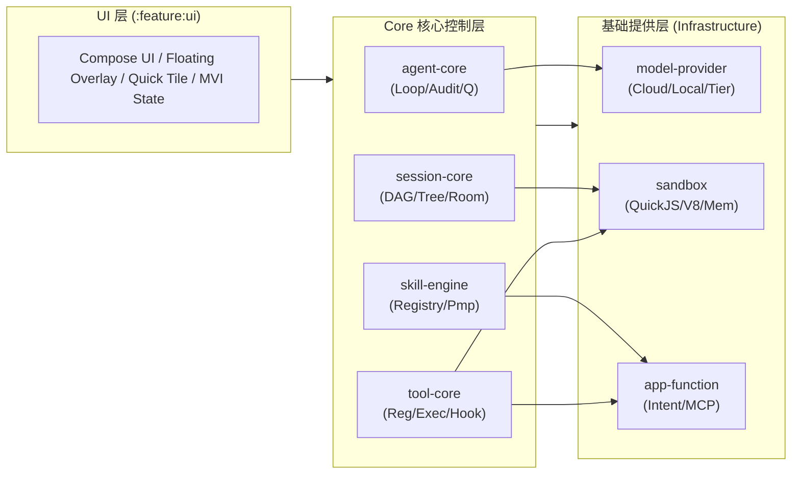

# 架构设计



---

### Core 核心层组件设计

**1. agent-core（驱动引擎与状态机）**

* `AgentLoopCoordinator.kt`：**主事件循环协调器**。持有 Coroutine 作用域，严格按时序驱动 Prompt 注入、模型推理、工具审计和队列流转。


* `MessageQueueManager.kt`：**双向消息队列管理器**。维护并发安全的 `Channel`，负责接收用户运行中的实时打断/转向（Steering）指令与系统自愈追问（Follow-up）指令。


* `AuditGatePipeline.kt`：**前置与后置双向审计门禁**。在工具执行前校验 Schema 并拦截高危权限（Pre-Tool Audit）；在工具返回后执行 PII 敏感数据脱敏与执行有效性校验（Post-Tool Gate）。


* `CompletionGuard.kt`：**终止拦截器**。当模型输出无 Tool Calling 的普通文本时，校验 To-Do 待办清单状态；若任务未闭环，生成 Follow-up 消息阻断终止并强行回推至下一轮循环。


* `ContextCompactor.kt`：**上下文压缩自愈引擎**。监控活跃分支 Token 水位，超限时触发端侧/云端 Summarizer，将历史工具链路无损压缩为摘要节点。


**2. session-core（状态树与持久化）**

* `SessionNode.kt` / `SessionTree.kt`：**DAG 树状节点与分支数据模型**。支持 `/tree` 分支分叉、时间线快照恢复与线性路径重构。


* `SessionDao.kt` / `SessionDatabase.kt`：**Room 数据库持久化组件**。存储多会话树的节点关系、输入输出上下文与元数据。


* `SessionRepository.kt`：**会话仓储接口与实现**。管理当前活跃节点游标（Active Node Pointer），向上层提供分支切换与历史切片。

**3. skill-engine（技能协议与动态注入）**

* `SkillRegistry.kt`：**技能与工具注册表**。管理本地/系统所有元工具，提供基于 Progressive Disclosure（渐进式暴露）的二级工具发现机制。


* `AgentSkill.kt` / `AgentTool.kt`：**轻量工具契约抽象**。定义名称、JSON Schema 参数规范、危险等级标识与挂起执行逻辑。


* `DynamicPromptInjector.kt`：**动态 Prompt 组装器**。按需将命中场景的 System Prompt、Skill 工具集定义及当前 To-Do 状态拼装为模型输入格式。


**4. tool-core（工具组件与统一执行内核）**

不管是 **To-Do 待办清单**、**多步思考（Progressive Reasoning）**，还是 **Skill 渐进式披露**，乃至后续尚未明确列出的各种元操作，最终都会被模型收敛为一次次的 **Tool Calling**。因此，架构中需要单独抽离一个 Tool 组件，承载「注册 — 披露 — 执行 — 审计」的统一内核，避免每个能力各自为政、各自造一套执行与校验机制。

* `ToolRegistry.kt`：**统一工具注册表**。作为全量可执行工具的唯一目录，聚合三类来源：① 内置工具（`builtin/` 内建集）；② skill 推导出的封闭工具（由 `skill-engine` 的 `SkillRegistry` 经渐进式披露后落盘）；③ 系统桥接工具（由基础层的 `app-function`、`sandbox` 适配而来）。提供按名称检索、Schema 导入、危险等级与权限分类。与 `skill-engine` 的职责边界为：skill-engine 负责"技能定义、检索与披露"；tool-core 负责"可执行工具的收敛、登记与执行"。


* `ProgressiveDisclosure.kt`：**渐进式披露驱动**。驱动 skill-engine 的二级工具发现——先按命中场景只注入一级 Skill 清单，当模型显式选定后再按需释放对应二级具体工具的 JSON Schema，避免一次性把所有工具塞进 Prompt 造成膨胀。


* `ToolExecutor.kt`：**工具执行内核**。对任意注册工具统一编排"解析参数 → Schema 校验 → Pre-Tool Audit 门禁 → 执行(同步/异步/沙箱) → Post-Tool Result 门禁 → 返回归一化结果"完整生命周期，并支持 HITL 挂起（交回 `AuditApprovalDialog`）。`agent-core` 的 Loop 只面向本执行器交互，不再各自持有执行细节。


* `BuiltInTools.kt`：**内置工具族**。集中承载与任务无关的固化元工具：
  * `TodoListTool.kt`：**To-Do 待办工具**。把大目标拆解/勾选/调整为一组可追踪子任务，写入 session-core；供 `CompletionGuard` 判定任务是否闭环。
  * `ThinkingTool.kt`：**多步推理工具**。把链式/树状的推理步骤显式落盘为可观测产物，中间态可审计、可回退、可经审计门禁判断。
  * `SkillResolverTool.kt`：**技能发现的工具化入口**。把"渐进式披露"本身也建模成一次 Tool Calling，由模型显式调起，命中 skill 后注册并暴露二级元工具。


---

### 基础提供层组件设计

**1. model-provider（端云双梯队模型接入）**

* `ModelProvider.kt`：**模型抽象网关**。统一规范流式输出（SSE Flow）、Tool Calling 结构化输出及单步 Generate 契约。


* `CloudModelClient.kt`：**云端模型调度器**。基于 Ktor Client 封装，负责流式对接 Claude、DeepSeek、OpenAI 等云端主推理引擎。


* `LocalModelEngine.kt`：**端侧轻量推理引擎**。封装 Google LiteRT / MNN 运行时，驱动 Qwen-2.5-1.5B INT4 模型完成离线意图路由与会话压缩。


* `DeviceCapabilityDetector.kt`：**双梯队探测器**。在启动时检测 API Level（$\ge 34$）、可用物理 RAM（$\ge 8\text{ GB}$）及 Vulkan 特性，动态决策分配 `HYBRID_LOCAL_CLOUD` 或 `CLOUD_ONLY` 运行模式。


**2. sandbox（轻量代码沙盒）**

* `ScriptSandbox.kt`：**纯内存脚本执行接口**。
* `QuickJsSandbox.kt`：**轻量 QuickJS 执行器**。内嵌纯 C 解释器（16KB Page Size 对齐编译），设置 8MB 内存上限与 200ms 执行超时硬配额，专门运行数据清洗、JSON 提取等胶水纯函数。


**3. app-function（系统元操作落地）**

* `AppFunctionBridge.kt`：**Android 15/16 原生 AppFunctions 协议客户端**。将标准应用能力转换为 Agent 可识别的结构化 Tool。
* `SystemIntentExecutor.kt`：**原生 Intent 分发器**。负责发起系统级日历写入、剪贴板读写、通知创建及第三方 App DeepLink 跳转。


* `AutomationFallbackGateway.kt`：**自动化降级执行网关**。在缺乏结构化接口时，统一调度 Shizuku / AccessibilityService 完成底层 UI 兜底模拟。


---

### UI 交互层组件设计 (`:feature:ui`)

* `AgentViewModel.kt`：**MVI 状态管理器**。连接 `AgentLoopCoordinator`，向界面暴露 `StateFlow<AgentUiState>` 并将用户点击或输入包装为 Steering 事件发射给 Core 层。


* `AgentConversationScreen.kt`：**Compose 主对话视窗**。负责流式 Token 渲染、DAG 树分支回退选择器与 Tool 执行折叠面板。


* `AuditApprovalDialog.kt`：**人机协同确认弹窗（HITL）**。当 `Pre-Tool Audit Gate` 拦截到高危操作时挂起并唤起此弹窗，等待用户生物识别或点击放行。


* `FloatingOverlayService.kt`：**系统悬浮窗/快捷图块（Tile）入口**。提供无感触发与全局屏幕感知的快捷交互界面。


---

### 核心 Agent Loop 调度驱动样板 (Kotlin)

```kotlin
class AgentLoopCoordinator(
    private val modelProvider: ModelProvider,
    private val queueManager: MessageQueueManager,
    private val auditGate: AuditGatePipeline,
    private val dynamicInjector: DynamicPromptInjector,
    private val compactor: ContextCompactor,
    private val completionGuard: CompletionGuard,
    private val toolExecutor: ToolExecutor, // tool-core：统一工具注册与执行内核
    private val disclosure: ProgressiveDisclosure // 渐进式披露驱动（Skill 二级工具）
) {
    suspend fun executeLoop(initialPrompt: String): Flow<AgentStepEvent> = flow {
        queueManager.enqueueUserPrompt(initialPrompt)

        while (true) {
            // 1. Check Message Queue (Steering and Follow-up)
            val incomingMessages = queueManager.drainQueue()
            
            // 2 & 3 & 4. Inject System Prompt, Skills/Tools, and Auto-Compaction
            val promptContext = dynamicInjector.assemble(incomingMessages)
            val compactedContext = compactor.compactIfNeeded(promptContext)
            
            // 5 & 6 & 7. Convert format and Send to LLM
            val payload = compactedContext.toModelPayload()
            val response = modelProvider.generate(payload)
            emit(AgentStepEvent.ModelResponse(response))

            // 8. Is response contains tool calling?
            if (response.hasToolCalls) {
                for (toolCall in response.toolCalls) {
                    // Pre-Tool Audit Gate
                    val auditDecision = auditGate.preToolAudit(toolCall)
                    if (!auditDecision.isPassed) {
                        queueManager.enqueueFollowUp("Audit rejected: ${auditDecision.reason}")
                        continue
                    }

                    // Progressive Disclosure：未注册的工具按需触发二级技能披露
                    disclosure.revealIfNeeded(toolCall.name)

                    // Tool Calling Execution (tool-core：统一生命周期编排)
                    val rawResult = toolExecutor.execute(toolCall)
                    
                    // Post-Tool Result Gate (Sanitize PII & self-correction)
                    val sanitizedResult = auditGate.postToolAudit(rawResult)
                    queueManager.enqueueToolResult(sanitizedResult)
                }
                // Next loop
                continue
            }

            // No Tool Calling -> Check Queue Status
            if (!queueManager.isEmpty()) {
                continue
            }

            // Completion Guard Check
            val completionResult = completionGuard.evaluate(compactedContext, response.text)
            if (completionResult.isCompleted) {
                emit(AgentStepEvent.Finished(response.text))
                break
            } else {
                // Not completed -> Inject Follow-up and proceed to next loop
                queueManager.enqueueFollowUp(completionResult.followUpInstruction)
            }
        }
    }
}

```